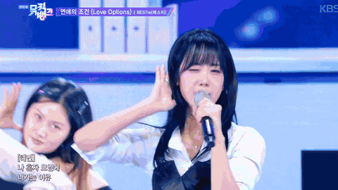
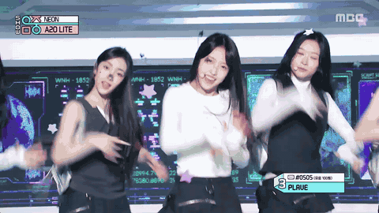

# kpop-stage-mix

[English](README.md) | [繁體中文](README.zh-TW.md) | **日本語** | [한국어](README.ko.md)

Claude Code と Codex で使えるエージェントスキルです。K-POP のステージミックス（交差編集／교차편집）を自動で編集します。1 曲を通して流しながら、映像を各音楽番組のステージの間で切り替えます。切り替わる瞬間も同じメンバーの顔が同じ位置・同じ大きさに留まるので、衣装とステージだけが入れ替わって見えます。

エージェントに「〈曲名〉のステージミックスを作って」（または "make a stage mix of …"、「幫我剪〈歌名〉的一鍵換裝」、「〈곡명〉 교차편집 만들어 줘」）と頼むと、このスキルが使われます。

## サンプル

4 本とも、このパイプラインが全自動で編集した完成版からの抜粋で、つなぎ目は一切手直ししていません。GIF は幅 480 px で、最初の 2 本は 15 fps、残りの 2 本は 29.97 fps です。

**連続切り替え：A2O LITE「NEON」、完成版の 1:05–1:11**

6 秒間に 4 回ステージが変わります：M2 → Show Champion → Music Bank → M2 → Show! Music Core。2 回目の切り替え先は 10 人のフォーメーションを映した引きの画で、カメラの方を向いている顔は 1 つだけです。その 1 つの顔で隊列全体を揃えています。


**同じメンバーで 4 回切り替え：BESTie「Love Options」、完成版の 1:10–1:17**

7 秒間の 4 回の切り替えが、すべて同じメンバーに合わせてあります：Music Bank → Show! Music Core（11/14）→ Show! Music Core（10/31）→ Music Bank → Show! Music Core（11/14）。途中の引きの画は放送局自身のカット割りです。



**3 人同時に位置合わせ：A2O LITE「NEON」、完成版の 3:10**

Show! Music Core → THE SHOW。3 人が横に並んでいるので、拡大と移動で 1 つではなく 3 つの顔を同時に元の位置へ合わせる必要があります。



**1 秒以内に 2 回、2 回目は 2 人まとめて：BESTie「Love Options」、完成版の 0:22–0:24**

Music Bank → Show! Music Core → 人気歌謡。2 回目の切り替えでは 2 人が同じ画面に入っていて、2 つの顔をまとめて合わせています。


## 内容

```
SKILL.md                 手順、各ステップの合格条件、既知の落とし穴、報告すべき内容
references/sourcing.md   各ステージとスタジオ音源の探し方・選び方・命名・ダウンロード
references/tuning.md     編集計画の決め方と調整できるパラメータ、人間の編集者の手法、他の作品を分析・比較するツール
scripts/                 パイプライン全体のツール（Python + ffmpeg）
```

| ツール | 役割 |
|---|---|
| `prep.py` | 解析用の音声と低解像度映像を書き出し、各ファイルのフレームレートを記録 |
| `sync.py` | スタジオ音源を基準に、各ステージの音声のずれを測定 |
| `vdelay.py` | 放送局ごとに、音に対する映像の遅れを推定 |
| `conform.py` | 各ステージを、曲のタイムラインに揃えた 1080p / 29.97 fps のファイルに変換 |
| `shots.py` | 放送局自身のカメラの切り替えを検出 |
| `faces.py` | フレームごとの顔検出と本人識別の特徴量（insightface） |
| `check_sync.py` | メンバーの顔の動きの軌跡から、ステージ間の映像のずれを測定。`--apply` で補正値を書き戻す |
| `beats.py` | 拍のグリッドと小節の頭 |
| `plan.py` | 衣装が切り替えられる箇所をすべて探し、動的計画法で曲全体の編集を決める |
| `render.py` | 編集どおりにレンダリング。デコードからエンコードまで YUV 4:2:0 のまま処理 |
| `sheet.py` | つなぎ目ごとに前後のコマを並べた確認用の画像 |
| `verify.py` | 完成版の検証：デコード、音声の位置、黒枠が出ないこと、コマの位置。人が見るべき箇所も挙げる |
| `analyze_mix.py` | 元のステージと照らし合わせて、他の人の作品の編集を逆算 |
| `compare.py` | 自分の完成版と他の作品を曲の時間で揃え、1 本の動画に並べる |
| `stagemix.py` | 共通モジュール：顔のトラッキング、ステージ間の照合、仮想カメラ |

## 必要なもの

- Linux または macOS（Windows は WSL）
- `ffmpeg`、`ffprobe`、`yt-dlp`、Python 3.10 以上
- NVIDIA GPU を推奨：顔検出は 1 フレームあたり約 6 ms、CPU では約 100 ms
- Python パッケージは `scripts/requirements.txt` にあります。仮想環境の作り方はスキルがエージェントに指示します
- 中間ファイルはステージ 1 本につき約 1 GB

## インストール

Claude Code：

```bash
git clone https://github.com/boson-1/kpop-stage-mix ~/.claude/skills/kpop-stage-mix
```

Codex：

```bash
git clone https://github.com/boson-1/kpop-stage-mix ~/.codex/skills/kpop-stage-mix
```

両方で 1 つを共有する場合：

```bash
git clone https://github.com/boson-1/kpop-stage-mix ~/kpop-stage-mix
ln -s ~/kpop-stage-mix ~/.claude/skills/kpop-stage-mix
ln -s ~/kpop-stage-mix ~/.codex/skills/kpop-stage-mix
```

インストール後、次に開いたセッションから読み込まれます。

## 注意

- 出力は 16:9、1920x1080、29.97 fps 固定で、音声はスタジオ音源です。
- 音楽番組のステージ映像と音源の著作権は放送局とレーベルにあります。ダウンロード、使用、完成版の公開の前に権利を確認してください。
- 顔モデルは insightface の `buffalo_l` で、ライセンスは非商用の研究用途に限られます。

## ライセンス

コードとドキュメントは [MIT License](LICENSE) で公開しています。

`samples/` の GIF は放送映像からの抜粋で、著作権は各放送局とレーベルにあります。MIT License の対象外で、編集の仕上がりを見せるためだけに置いています。
