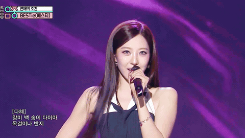
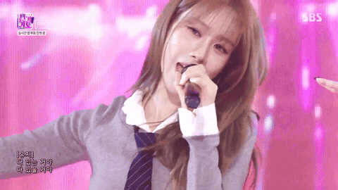
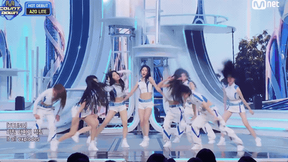
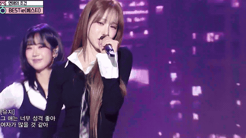
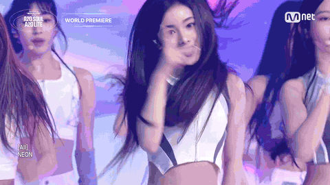
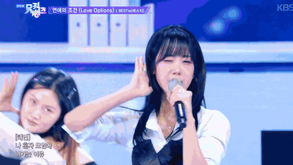
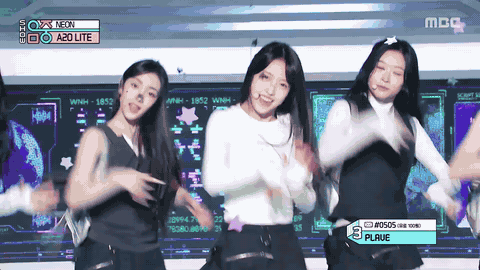
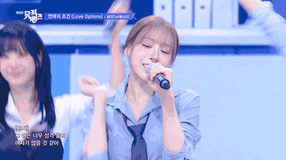

# kpop-stage-mix

[English](README.md) | [繁體中文](README.zh-TW.md) | [日本語](README.ja.md) | **한국어**

Claude Code와 Codex에서 쓰는 에이전트 스킬로, K팝 교차편집(stage mix)을 자동으로 만듭니다. 노래 한 곡을 끊김 없이 재생하면서 화면만 여러 음악방송 무대 사이를 오갑니다. 화면이 바뀌는 순간에도 같은 멤버의 얼굴이 같은 위치, 같은 크기에 머물러서 의상과 무대만 바뀌는 것처럼 보입니다.

전환은 대부분 몇 프레임짜리 디졸브입니다. 강박에 맞는 전환에는 마스크 트랜지션을 씁니다. 새 무대가 먼저 멤버의 얼굴에만 나타났다가 몇 프레임 뒤 불규칙하게 빛나는 경계와 함께 화면 전체로 퍼지는 블룸, 얼굴에서 원이 퍼져 나가는 아이리스, 부드러운 경계선이 화면을 훑고 지나가는 스윕 세 가지입니다.

에이전트에게 「〈곡명〉 교차편집 만들어 줘」(또는 "make a stage mix of …", 「幫我剪〈歌名〉的一鍵換裝」, 「〈曲名〉のステージミックスを作って」)라고 하면 이 스킬이 쓰입니다.

## 샘플

모두 이 파이프라인이 전자동으로 편집한 완성본에서 발췌했으며, 이음새를 손으로 고친 곳은 없습니다. GIF는 가로 480px입니다.

### 마스크 트랜지션

v0.4로 편집한 것입니다. GIF는 29.97fps라서 트랜지션의 모든 프레임이 들어 있습니다.

**블룸: BESTie 〈연애의 조건 (Love Options)〉, 완성본 0:46–0:48**

쇼! 음악중심(10/31) → 쇼! 음악중심(11/14). 새 무대가 먼저 멤버의 얼굴에만 나타나고(머리와 의상은 이전 그대로), 이어서 불규칙하게 빛나는 경계와 함께 화면 전체로 퍼집니다. 얼굴 하나만 맞췄고 두 마디마다의 첫 박에 걸리는 전환에 씁니다.



**아이리스: BESTie 〈연애의 조건 (Love Options)〉, 완성본 0:55–0:58**

인기가요 → 쇼! 음악중심(10/31). 맞춘 얼굴에서 경계가 부드러운 원이 퍼져 나갑니다. 나머지 마디 첫 박에 씁니다.



**위에서 아래로 스윕: A2O LITE 〈NEON〉, 완성본 2:52–2:54**

엠카운트다운 → 더쇼. 부드러운 경계선이 화면을 위에서 아래로 내려가며, 전환되는 프레임에 맞춘 얼굴을 지나갑니다. 마디의 셋째 박에 씁니다.



**가로 스윕: BESTie 〈연애의 조건 (Love Options)〉, 완성본 0:22–0:24**

쇼! 음악중심(10/31) → 인기가요. 두 멤버의 얼굴을 맞췄기 때문에 경계선이 두 사람이 움직이는 방향으로 화면을 가로지릅니다. 아래 디졸브 샘플 중 마지막 것의 두 번째 전환과 같은 지점입니다.



### 디졸브

전환은 지금도 대부분 2~4프레임짜리 디졸브입니다. 아래 네 개는 v0.1로 만든 것으로, 당시에는 모든 전환이 디졸브였습니다. 앞의 두 개는 15fps, 뒤의 두 개는 29.97fps입니다.

**연속 전환: A2O LITE 〈NEON〉, 완성본 1:05–1:11**

6초 동안 무대가 네 번 바뀝니다: M2 → 쇼챔피언 → 뮤직뱅크 → M2 → 쇼! 음악중심. 두 번째 전환은 열 명이 선 대형을 멀리서 잡은 화면으로, 카메라를 보는 얼굴이 하나뿐입니다. 그 얼굴 하나로 대형 전체를 맞췄습니다.



**한 멤버로 네 번 전환: BESTie 〈연애의 조건 (Love Options)〉, 완성본 1:10–1:17**

7초 동안의 네 번의 전환이 모두 같은 멤버에게 맞춰져 있습니다: 뮤직뱅크 → 쇼! 음악중심(11/14) → 쇼! 음악중심(10/31) → 뮤직뱅크 → 쇼! 음악중심(11/14). 중간의 원경은 방송사가 직접 넘긴 컷입니다.



**세 명 동시 정렬: A2O LITE 〈NEON〉, 완성본 3:10**

쇼! 음악중심 → 더쇼. 세 멤버가 나란히 서 있어서, 확대와 이동으로 얼굴 하나가 아니라 세 얼굴을 동시에 제자리에 맞춰야 합니다.



**1초 안에 두 번, 두 번째는 두 명을 함께: BESTie 〈연애의 조건 (Love Options)〉, 완성본 0:22–0:24**

뮤직뱅크 → 쇼! 음악중심 → 인기가요. 두 번째 전환에서는 두 멤버가 한 화면에 함께 있고, 두 얼굴을 한꺼번에 맞췄습니다.



## 구성

```
SKILL.md                    작업 순서, 단계별 통과 기준, 알려진 함정, 보고할 내용
references/sourcing.md      무대 영상과 스튜디오 음원을 찾고, 고르고, 이름 붙이고, 내려받는 방법
references/tuning.md        편집 계획을 세우는 방식과 조정할 수 있는 값, 사람 편집자의 기법, 다른 작품을 분석·비교하는 도구
references/transitions.md   마스크 트랜지션, 그 바탕이 된 영화·방송, 편집 소프트웨어, 모션 라이브러리의 기법, 새로 추가하는 방법
scripts/                    전체 파이프라인 도구 (Python + ffmpeg)
```

| 도구 | 역할 |
|---|---|
| `prep.py` | 분석용 오디오와 저해상도 영상을 추출하고, 파일별 프레임레이트를 기록 |
| `sync.py` | 스튜디오 음원을 기준으로 무대별 오디오 시차를 측정 |
| `vdelay.py` | 방송사별로 소리 대비 화면이 얼마나 늦는지 추정 |
| `conform.py` | 무대마다 곡의 타임라인에 맞춘 1080p / 29.97fps 파일로 변환 |
| `shots.py` | 방송사가 직접 넘긴 카메라 컷을 검출 |
| `faces.py` | 프레임별 얼굴 검출과 신원 특징 (insightface) |
| `check_sync.py` | 멤버 얼굴의 움직임 궤적으로 무대 간 화면 동기를 측정, `--apply`로 보정값을 반영 |
| `beats.py` | 박자 격자와 마디 시작점 |
| `plan.py` | 의상을 바꿀 수 있는 지점을 모두 찾고, 동적 계획법으로 곡 전체의 편집을 결정한 뒤, 강박에 맞는 전환에 마스크 트랜지션을 지정 |
| `render.py` | 편집대로 렌더링(디졸브, 블룸, 아이리스, 스윕), 디코딩부터 인코딩까지 YUV 4:2:0 유지 |
| `sheet.py` | 이음새마다 앞뒤 프레임을 모은 확인용 이미지 |
| `verify.py` | 완성본 검증: 디코딩, 오디오 위치, 테두리 노출 여부, 프레임 위치. 사람이 직접 봐야 할 곳도 알려 줌 |
| `analyze_mix.py` | 원본 무대와 대조해 다른 사람 작품의 편집을 역산 |
| `compare.py` | 내 완성본과 다른 작품을 곡 시간에 맞춰 한 영상에 나란히 배치 |
| `stagemix.py` | 공통 모듈: 얼굴 추적, 무대 간 매칭, 가상 카메라 |

## 요구 사항

- Linux 또는 macOS (Windows는 WSL)
- `ffmpeg`, `ffprobe`, `yt-dlp`, Python 3.10 이상
- NVIDIA GPU 권장: 얼굴 검출이 프레임당 약 6ms, CPU에서는 약 100ms
- Python 패키지는 `scripts/requirements.txt`에 있으며, 가상환경 구성은 스킬이 에이전트에게 안내합니다
- 중간 파일은 무대 하나당 약 1GB

## 설치

Claude Code:

```bash
git clone https://github.com/boson-1/kpop-stage-mix ~/.claude/skills/kpop-stage-mix
```

Codex:

```bash
git clone https://github.com/boson-1/kpop-stage-mix ~/.codex/skills/kpop-stage-mix
```

하나를 두 곳에서 같이 쓰려면:

```bash
git clone https://github.com/boson-1/kpop-stage-mix ~/kpop-stage-mix
ln -s ~/kpop-stage-mix ~/.claude/skills/kpop-stage-mix
ln -s ~/kpop-stage-mix ~/.codex/skills/kpop-stage-mix
```

설치한 다음 새로 여는 세션부터 불러옵니다.

## 주의 사항

- 출력은 16:9, 1920x1080, 29.97fps로 고정되며, 오디오는 스튜디오 음원입니다.
- 음악방송 무대 영상과 음원의 저작권은 방송사와 음반사에 있습니다. 내려받거나 사용하거나 완성본을 공개하기 전에 권리를 확인하세요.
- 얼굴 모델은 insightface의 `buffalo_l`이며, 라이선스상 비상업적 연구 용도로만 쓸 수 있습니다.

## 라이선스

코드와 문서는 [MIT License](LICENSE)로 공개합니다.

`samples/`의 GIF는 방송 화면에서 발췌한 것으로, 저작권은 각 방송사와 음반사에 있습니다. MIT License 대상이 아니며 편집 결과를 보여 주기 위해서만 넣었습니다.
