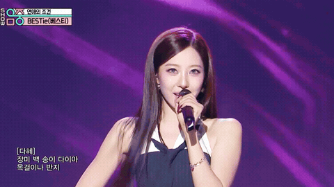
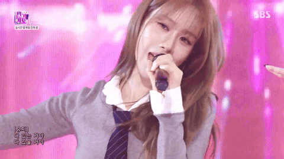
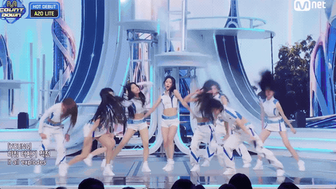
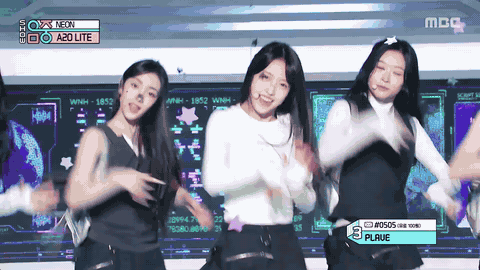

# kpop-stage-mix

**English** | [繁體中文](README.zh-TW.md) | [日本語](README.ja.md) | [한국어](README.ko.md)

An agent skill for Claude Code and Codex that cuts a K-pop stage mix (교차편집, 一鍵換裝): one song plays straight through while the picture jumps between the group's performances on different music shows. At every jump the same member's face stays at the same place and size, so only the outfit and the stage change.

Most jumps are a dissolve of a few frames. Jumps that land on a strong beat get a mask transition instead: a bloom, in which the new stage first shows on the member's face alone and then spreads over the frame behind a ragged, lit edge; an iris, a circle that opens out of the face; or a soft edge that sweeps over the frame.

Ask the agent to "make a stage mix of &lt;song&gt;" (or 「幫我剪〈歌名〉的一鍵換裝」, 「〈曲名〉のステージミックスを作って」, 「〈곡명〉 교차편집 만들어 줘」) and the skill takes over.

## Samples

All excerpts come from mixes the pipeline cut fully automatically; no join was fixed by hand. The GIFs are 480 px wide.

### Mask transitions

Cut with v0.4. The GIFs run at 29.97 fps, so every frame of a transition is in them.

**Bloom: BESTie "Love Options", 0:46–0:48**

Show! Music Core (Oct 31) → Show! Music Core (Nov 14). The new stage first shows on the member's face alone, in the old hair and outfit, then spreads over the frame behind a ragged, lit edge. Used where one face is matched and the change lands on the start of every second bar.



**Iris: BESTie "Love Options", 0:55–0:58**

Inkigayo → Show! Music Core (Oct 31). A soft-edged circle opens out of the matched face. Used on the other bar starts.



**Sweep down: A2O LITE "NEON", 2:52–2:54**

M Countdown → THE SHOW. A soft edge runs down the frame and passes the matched face on the frame of the change. Used on beat 3 of the bar.



**Sweep across: BESTie "Love Options", 0:22–0:24**

Show! Music Core (Oct 31) → Inkigayo. Two members are matched, so the edge crosses the frame the way they are moving. It is the second change of the last dissolve sample below.


### Dissolves

Most changes are still a dissolve of 2 to 4 frames. These four excerpts were cut with v0.1, where every change was one. The first two run at 15 fps, the last two at 29.97 fps.

**Rapid changes: A2O LITE "NEON", 1:05–1:11 of the mix**

Four stage changes in 6 seconds: M2 → Show Champion → Music Bank → M2 → Show! Music Core. The second change lands on a wide shot of a ten-member formation in which only one face looks at the camera; that one face lines up the whole formation.


**One member, four changes: BESTie "Love Options", 1:10–1:17**

All four changes within 7 seconds land on the same member: Music Bank → Show! Music Core (Nov 14) → Show! Music Core (Oct 31) → Music Bank → Show! Music Core (Nov 14). The wide shot in the middle is the broadcaster's own cut.


**Three faces at once: A2O LITE "NEON", 3:10**

Show! Music Core → THE SHOW. Three members stand side by side, so zoom and shift have to put all three faces back in place, not just one.



**Two changes within a second, the second on a pair: BESTie "Love Options", 0:22–0:24**

Music Bank → Show! Music Core → Inkigayo. At the second change two members share the frame, and both faces are aligned together.


## Contents

```
SKILL.md                    workflow, the pass condition of every step, known pitfalls, what to report
references/sourcing.md      finding, choosing, naming and downloading the stages and the studio recording
references/tuning.md        how the edit is planned and what can be tuned, how human editors work, tools to analyse and compare other mixes
references/transitions.md   the mask transitions, the techniques from film, editing software and motion libraries they were chosen from, how to add one
scripts/                    the tools of the whole pipeline (Python + ffmpeg)
```

| Tool | What it does |
|---|---|
| `prep.py` | extracts the audio and low-resolution video used for analysis, records each file's frame rate |
| `sync.py` | measures each stage's audio offset against the studio recording |
| `vdelay.py` | estimates how much each broadcaster delays picture against sound |
| `conform.py` | turns every stage into a 1080p / 29.97 fps file aligned to the song's timeline |
| `shots.py` | detects the broadcast director's own camera cuts |
| `faces.py` | face detection and identity features for every frame (insightface) |
| `check_sync.py` | measures the picture sync between stages from the members' face trajectories; `--apply` writes the correction back |
| `beats.py` | beat grid and bar starts |
| `plan.py` | finds every point where the outfit can change, picks the edit for the whole song by dynamic programming, and gives the changes on strong beats a mask transition |
| `render.py` | renders the edit with its dissolves, blooms, irises and sweeps, staying in YUV 4:2:0 from decoder to encoder |
| `sheet.py` | contact sheets of the frames around every join, for checking them one by one |
| `verify.py` | checks the finished video: decoding, audio position, no visible border, frame placement; lists what a person should watch |
| `analyze_mix.py` | reconstructs the edit of someone else's mix by matching it against the original stages |
| `compare.py` | puts your mix and other mixes side by side in one video, aligned to the song |
| `stagemix.py` | shared module: face tracks, matching across stages, virtual camera |

## Requirements

- Linux or macOS (Windows through WSL)
- `ffmpeg`, `ffprobe`, `yt-dlp`, Python 3.10 or newer
- An NVIDIA GPU is recommended: face detection takes about 6 ms per frame on it, about 100 ms on a CPU
- Python packages are listed in `scripts/requirements.txt`; the skill tells the agent how to set up the virtual environment
- About 1 GB of intermediate files per stage

## Installation

Claude Code:

```bash
git clone https://github.com/boson-1/kpop-stage-mix ~/.claude/skills/kpop-stage-mix
```

Codex:

```bash
git clone https://github.com/boson-1/kpop-stage-mix ~/.codex/skills/kpop-stage-mix
```

One copy shared by both:

```bash
git clone https://github.com/boson-1/kpop-stage-mix ~/kpop-stage-mix
ln -s ~/kpop-stage-mix ~/.claude/skills/kpop-stage-mix
ln -s ~/kpop-stage-mix ~/.codex/skills/kpop-stage-mix
```

The skill is loaded from the next new session on.

## Notes

- Output is always 16:9, 1920x1080, 29.97 fps, with the studio recording as sound.
- Music-show stages and recordings are copyrighted by the broadcasters and labels. Check your rights before downloading, using or publishing a mix.
- The face models are insightface's `buffalo_l`, licensed for non-commercial research only.

## License

Code and documentation are released under the [MIT License](LICENSE).

The GIFs in `samples/` are excerpts of broadcast footage. Their copyright belongs to the broadcasters and labels; they are not covered by the MIT License and are included only to show what the edit looks like.
