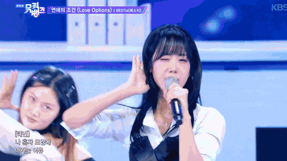
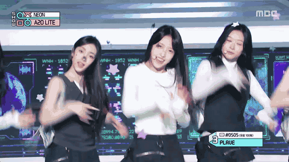

# kpop-stage-mix

[English](README.md) | **繁體中文** | [日本語](README.ja.md) | [한국어](README.ko.md)

給 Claude Code 與 Codex 使用的 Agent Skill：把同一首歌在各音樂節目的打歌舞台，剪成一支「一鍵換裝」stage mix（교차편집）。整首歌連續播放，畫面在不同場次之間切換，切換瞬間同一位成員的臉停在同樣的位置與大小，只有服裝和舞台換掉。

對 agent 說「幫我剪〈歌名〉的一鍵換裝」（或 "make a stage mix of …"、「〈曲名〉のステージミックスを作って」、「〈곡명〉 교차편집 만들어 줘」）就會觸發。

## 樣片

以下四段都節錄自這套流程全自動剪出的成片，沒有手動修過接點。GIF 寬 480 px；前兩段為 15 fps，後兩段為 29.97 fps。

**連續切換：A2O LITE〈NEON〉，成片 1:05–1:11**

6 秒內換 4 次舞台：M2 → Show Champion → Music Bank → M2 → Show! Music Core。第二次切換是十人隊形的遠景，只有一張臉朝向鏡頭，就靠這張臉把整排隊形對齊。


**同一位成員連換：BESTie〈Love Options〉，成片 1:10–1:17**

鏡頭一直跟著同一位成員，7 秒內換 4 次舞台：Music Bank → Show! Music Core 11/14 → Show! Music Core 10/31 → Music Bank → Show! Music Core 11/14。中間一段是電視台自己切的遠景。



**三人同時對位：A2O LITE〈NEON〉，成片 3:10**

Show! Music Core → THE SHOW。三位成員並排，縮放和位移要讓三張臉同時落在原位，不只對準一張。



**1 秒內連換兩次，第二次兩人同框：BESTie〈Love Options〉，成片 0:22–0:24**

Music Bank → Show! Music Core → 人氣歌謠。第二次切換時兩位成員同框，兩張臉一起對位。


## 內容

```
SKILL.md                 流程、每一步的過關條件、已知的坑、回報內容
references/sourcing.md   怎麼找、篩選、命名、下載各場舞台與錄音室音源
references/tuning.md     剪接規劃的規則與可調參數、別人的剪法、分析與比對別人作品的工具
scripts/                 整條流程的工具（Python + ffmpeg）
```

| 工具 | 作用 |
|---|---|
| `prep.py` | 抽出分析用的音訊與低解析度畫面，記錄各檔案的幀率 |
| `sync.py` | 以錄音室音源為基準，算出每一場的音訊時間差 |
| `vdelay.py` | 估計各電視台畫面相對聲音的延遲 |
| `conform.py` | 把每一場轉成對齊歌曲時間軸的 1080p / 29.97 fps 檔案 |
| `shots.py` | 偵測導播自己的鏡頭切換 |
| `faces.py` | 逐格人臉偵測與身分特徵（insightface） |
| `check_sync.py` | 用成員臉部運動軌跡量測各場之間的畫面同步，`--apply` 寫回校正 |
| `beats.py` | 節拍格線與小節起點 |
| `plan.py` | 找出所有可換裝的位置，用動態規劃選出整首歌的剪接表 |
| `render.py` | 依剪接表算圖，全程 YUV 4:2:0 |
| `sheet.py` | 每個接點前後的截圖表，供逐一檢查 |
| `verify.py` | 成片驗證：解碼、音訊位置、不露邊、畫面格位，並列出需要人看的地方 |
| `analyze_mix.py` | 對照原始舞台，逆向還原別人作品的剪接表 |
| `compare.py` | 把成品和別人的作品依歌曲時間對齊，並排成一支影片 |
| `stagemix.py` | 共用模組：人臉軌跡、跨場配對、虛擬鏡頭 |

## 需求

- Linux 或 macOS（Windows 請用 WSL）
- `ffmpeg`、`ffprobe`、`yt-dlp`、Python 3.10 以上
- 建議有 NVIDIA GPU：人臉偵測每格約 6 ms，CPU 約 100 ms
- Python 套件見 `scripts/requirements.txt`，skill 會引導 agent 建立虛擬環境
- 每一場舞台約佔 1 GB 中間檔

## 安裝

Claude Code：

```bash
git clone https://github.com/boson-1/kpop-stage-mix ~/.claude/skills/kpop-stage-mix
```

Codex：

```bash
git clone https://github.com/boson-1/kpop-stage-mix ~/.codex/skills/kpop-stage-mix
```

兩邊共用同一份：

```bash
git clone https://github.com/boson-1/kpop-stage-mix ~/kpop-stage-mix
ln -s ~/kpop-stage-mix ~/.claude/skills/kpop-stage-mix
ln -s ~/kpop-stage-mix ~/.codex/skills/kpop-stage-mix
```

裝好後開新的 session 才會載入。

## 注意事項

- 輸出固定為 16:9、1920x1080、29.97 fps，音軌用錄音室版。
- 打歌舞台與音源的著作權屬於電視台與唱片公司，下載、使用與公開成品前請自行確認權利。
- 人臉模型使用 insightface 的 `buffalo_l`，其授權僅限非商業研究用途。

## 授權

程式碼與文件以 [MIT License](LICENSE) 授權。

`samples/` 裡的 GIF 節錄自電視台的打歌舞台畫面，著作權屬於各電視台與唱片公司，不在 MIT 授權範圍內，放在這裡只為展示剪接效果。
